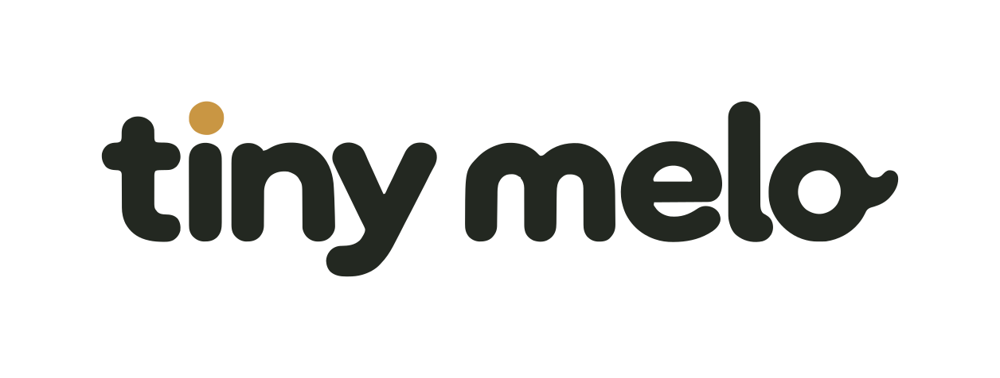
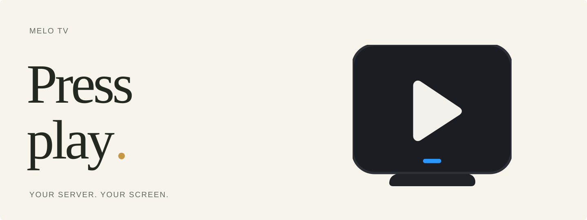
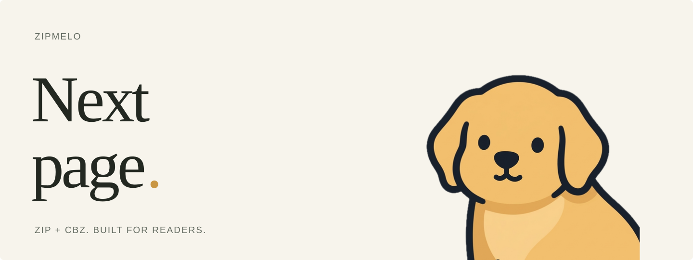

<picture>
  <source media="(prefers-color-scheme: dark)" srcset="https://raw.githubusercontent.com/Tiny-Melo/.github/main/profile/assets/editorial/wordmark-reverse.svg">
  <source media="(prefers-color-scheme: light)" srcset="https://raw.githubusercontent.com/Tiny-Melo/.github/main/profile/assets/editorial/wordmark-brand.svg">
  
</picture>

### Little tools. A lot of heart.

Independent apps and tools by [Christopher](https://github.com/ChrisRodStar). A place for the things I build, from watching movies to reading comics.

 

## Melo TV

**Movies and TV from your own server.**

Run the server on your Mac or with Docker. Watch on your Mac, iPhone, or in your browser. Built because picking something to watch shouldn't mean fighting popups and fake play buttons.

**[Explore Melo TV →](https://github.com/ChrisRodStar/Mello-Tv)** &nbsp; · &nbsp; [Downloads](https://github.com/ChrisRodStar/Mello-Tv/releases)

 

## ZipMelo

**The archive engine behind a better reading experience.**

A Swift 6 ZIP and CBZ library built for comic and manga readers. Natural page ordering, concurrent archive reads, and ComicInfo metadata, with a macOS command-line tool for working with archives directly.

**[Explore ZipMelo →](https://github.com/ChrisRodStar/zipmello)** &nbsp; · &nbsp; [Releases](https://github.com/ChrisRodStar/zipmello/releases)

 

---

**Small software. Made with care.**

Tiny Melo is named after my golden retriever, Melo. I write the software. He keeps me company.

[Christopher](https://github.com/ChrisRodStar) &nbsp; / &nbsp; [Support my work](https://buymeacoffee.com/chrissinclair)
