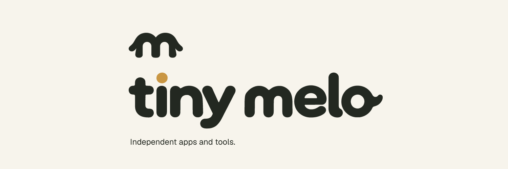

  <picture>
    <source media="(prefers-color-scheme: dark)" srcset="assets/banner-dark.png">
    <source media="(prefers-color-scheme: light)" srcset="assets/banner-light.png">
    
  </picture>

  
  
  
  

<h3 align="center"><i>Little tools. A lot of heart.</i></h3>

  A home for thoughtful apps, useful tools, and the occasional rabbit hole. 
  Built with care by <b>Christopher</b>, approved by <b>Melo</b> the golden retriever.

---

### ✨ Featured Projects

<table>
  <tr>
    <td width="120" align="center" valign="middle">
      
    </td>
    <td>
      <h4><a href="https://github.com/ChrisRodStar/zipmelo">ZipMello</a> &nbsp;<code>Open Source</code> <code>Swift 6</code></h4>
      
<b>A high-performance ZIP and CBZ engine built around comic and manga reading patterns.</b>

      <ul>
        <li><b>Seek-Lock-Free Positional Reads</b>: Independent <code>pread</code> calls enable non-blocking background page prefetching.</li>
        <li><b>55× Faster Path Lookups</b>: Average <i>O</i>(1) path and alias indexing with zero linear scans.</li>
        <li><b>Bounded Page Leasing</b>: Reference-counted <code>ArchivePageStore</code> with disk budgets and LRU cache eviction.</li>
        <li><b>Zero-Disk Streaming &amp; CLI</b>: Decompresses directly from in-memory network buffers, plus a universal macOS CLI.</li>
      </ul>
      

        <a href="https://github.com/ChrisRodStar/zipmelo"><b>View Repository →</b></a> &nbsp;|&nbsp;
        <a href="https://github.com/ChrisRodStar/zipmelo/releases"><b>Releases</b></a>
      

    </td>
  </tr>
  <tr>
    <td width="120" align="center" valign="middle">
      
    </td>
    <td>
      <h4><a href="https://github.com/ChrisRodStar/Mello-Tv">Mello TV</a> &nbsp;<code>Self-Hosted</code> <code>App Suite</code></h4>
      
<b>A clean, ad-free streaming server and client suite for movies and TV shows.</b>

      <ul>
        <li><b>Distraction-Free</b>: Built to replace ad-heavy, pop-up-filled streaming sites with a calm, beautiful player.</li>
        <li><b>Multi-Platform Suite</b>: Native Mac app, sideloadable iOS client, and responsive web browser player.</li>
        <li><b>One-Command Docker Setup</b>: Deploy effortlessly with Docker Compose; keeps watch history and profiles persistent.</li>
        <li><b>Rich Metadata</b>: Automatic metadata, episode guides, and poster artwork powered by TMDB.</li>
      </ul>
      

        <a href="https://github.com/ChrisRodStar/Mello-Tv"><b>View Repository →</b></a> &nbsp;|&nbsp;
        <a href="https://github.com/ChrisRodStar/Mello-Tv/releases"><b>Releases</b></a>
      

    </td>
  </tr>
</table>

---

### 🛠️ From the Workbench

Projects currently brewing, in active development, or in public beta:

<table>
  <tr>
    <td width="100" align="center" valign="middle">
      
    </td>
    <td>
      <b>BrewPulse</b> &nbsp;<code>Public Beta</code> <code>macOS</code> 
      A lightweight native menu bar app for tracking Homebrew updates without living in the Terminal. Shows outdated formulae and casks, letting you review the exact command before it runs. 
      <a href="https://github.com/ChrisRodStar/BrewPulse"><b>View Source →</b></a>
    </td>
  </tr>
  <tr>
    <td width="100" align="center" valign="middle">
      
    </td>
    <td>
      <b>Melloku</b> &nbsp;<code>In Development</code> <code>iOS &amp; macOS</code> 
      Your manga. Your pace. A native Apple-first manga and comics reader designed around a comfortable reading library, reading history, and high-speed chapter transitions (powered by ZipMello).
    </td>
  </tr>
  <tr>
    <td width="100" align="center" valign="middle">
      
    </td>
    <td>
      <b>Speakmelo</b> &nbsp;<code>In Development</code> <code>macOS</code> 
      From a thought to a sentence. Native, private on-device dictation for your Mac featuring a global recording overlay, custom vocabulary, and instant text delivery to any active application.
    </td>
  </tr>
  <tr>
    <td width="100" align="center" valign="middle">
      
    </td>
    <td>
      <b>Tiny Melo Showcase</b> &nbsp;<code>Open Source</code> <code>Astro &amp; Bun</code> 
      The personal showcase website for Tiny Melo's apps, tools, and branding system, built with Astro, Bun, and GSAP motion. 
      <a href="https://github.com/Tiny-Melo/tiny-melo"><b>View Website Repo →</b></a>
    </td>
  </tr>
</table>

---

### 🐾 Studio Philosophy

- **Native & Purpose-Built**: Tailored for Apple platforms. We build with modern Swift, strict concurrency, and native frameworks rather than sluggish cross-platform wrappers.
- **Under the Hood Quality**: Thoughtful, quiet interfaces backed by serious performance engineering—whether that's lock-free positional I/O, bounded memory budgets, or zero-copy streaming.
- **Honest Software**: No deceptive dark patterns, no unsolicited analytics, and no bloat. Just software that does what it says on the tin.

---

### 🐶 The Team

<table>
  <tr>
    <td width="80" align="center">
      
    </td>
    <td>
      <b>Christopher</b> — <i>Human / Engineering &amp; Design</i> 
      Architecting native Apple apps, developer libraries, and small experiments.  
      <b>Melo</b> — <i>Golden Retriever / Head of Taking It Easy</i> 
      The namesake behind the studio. Supplies the laid-back energy, moral support, and quality assurance naps.
    </td>
  </tr>
</table>

---

   
  Crafted with care by Christopher &amp; Melo. 
  <a href="https://github.com/Tiny-Melo">Tiny Melo</a> • <a href="https://github.com/ChrisRodStar">@ChrisRodStar</a> • <a href="https://buymeacoffee.com/chrissinclair">Buy Me a Coffee</a>

